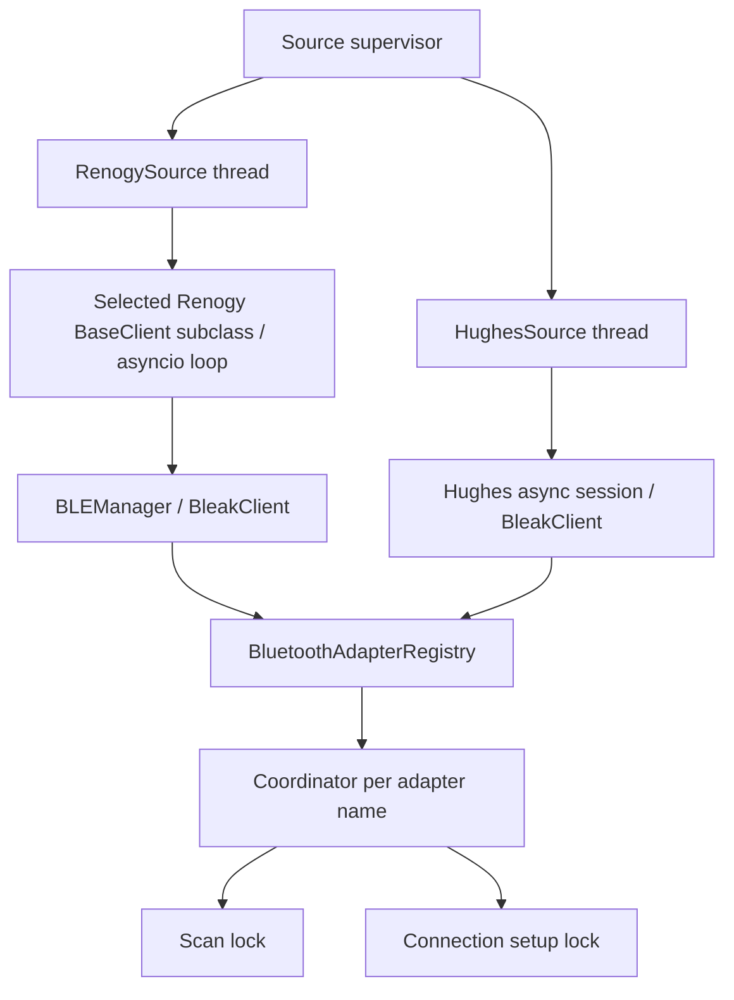

# BLE connection reliability: implemented design

This document describes the current Renogy and Hughes implementation, not a
proposal for a new shared session framework. The original design's
`BleSource`, `BleDeviceSession`, `RenogySession`, `HughesSession`, and
`BleSessionSettings` classes do **not** exist.

Use [config-example.ini](../config-example.ini) for installation settings and
the [README](../README.md#bluetooth-discovery) for initial discovery. Bluetooth
Classic OBD-II is a separate source; it shares connection coordination but
does not use the BLE protocols described here.

## Ownership and isolation

Each enabled configuration section creates its own
[Source](../src/rv_control/sources/base.py) thread. Multiple Renogy or Hughes
sections can coexist. Each owns its client/session state; no global BLE worker
or shared `BleakClient` carries device telemetry.

Implementation boundaries:

- [RenogySource](../src/rv_control/sources/renogy.py) maps INI configuration,
  selects a register client, publishes results, and forwards optional commands.
- [BaseClient](../src/rv_control/sources/renogybt/BaseClient.py) owns Renogy
  polling, read timeouts, retry scheduling, task generations, and loop cleanup.
- [BLEManager](../src/rv_control/sources/renogybt/BLEManager.py) owns Renogy
  discovery, GATT setup, notification forwarding, and disconnect cleanup.
- [HughesSource](../src/rv_control/sources/hughes.py) owns its own async reconnect
  loop, notification buffering/decoding, and optional legacy 50A leg aggregation.
- [bluetooth.py](../src/rv_control/bluetooth.py) provides coordination and
  best-effort orphaned BlueZ link release.

## Adapter coordination

`BluetoothAdapterRegistry.for_adapter(name)` returns a process-wide coordinator
keyed by the stripped adapter name (blank becomes `hci0`). Each coordinator has
two independent `threading.Lock` objects. Async context managers acquire them
via `asyncio.to_thread`, allowing sharing across source threads/event loops.

| Operation | Current coordinated callers |
| --- | --- |
| `scan_slot()` | Renogy `BLEManager.discover`. |
| `connect_slot()` | Renogy GATT connect and Hughes daemon client context entry. |
| `connect_slot_sync()` | OBD RFCOMM connection setup; shares the connect lock. |

Scans serialize with other coordinated scans; connects serialize with other
coordinated connects. The two locks do **not** exclude scans from connects.
Locks are released after setup, so active connections remain independent.
Hughes connects by address without an explicit daemon scan. BLE communication
checks, Hughes interrogation, and the standalone discovery tool do not use
these coordination slots. This is process-local coordination, not a lock against
phone apps, other processes, or all BlueZ activity.

There is no connection-capacity setting, device-address reservation,
duplicate-address rejection, adapter cooldown, or `release(address)` registry
method. Configure one source owner per physical device yourself. Adapter keys
are names, not a general normalization of controller MAC aliases.

## Renogy lifecycle

The daemon builds client configuration once per worker and always enables
polling. `persistent_connection` decides whether the link stays open, not
whether `run` collects repeatedly:

- **Persistent:** discover/connect/subscribe, read the configured register
  sections, publish, wait `poll_interval`, and read again on the same link.
- **Nonpersistent:** read/publish, disconnect and release the link, wait
  `poll_interval`, then rediscover and reconnect. This leaves a single-connection
  peripheral available to its phone app between polls.

The client uses `asyncio.run` for its owned event loop. Normal successful
connection setup resets its retry counter before register reads.
Failed setup, unexpected disconnects, and read timeouts feed one retry worker.
Failures arriving during connection setup are retained until setup returns,
rather than starting overlapping reconnect attempts.

Before retrying, the worker invalidates older read chains with a generation
increment, cancels read/poll timers, disconnects, normally discards the manager,
and sleeps with backoff. A new manager discovers the device and resolves fresh
GATT characteristics. If manager disconnect raises, it is logged and the
reference may remain; fresh-manager replacement is not an unconditional
guarantee on every teardown failure.

Discovery matches configured MAC **or** alias. `comms-check` is stricter and
checks the address and expected alias. A duplicate alias can therefore make
runtime discovery ambiguous; use unique, accurate installation settings.

The manager suppresses intentional, duplicate, and setup-time disconnect
callbacks and ignores disconnects from a replaced client. Generation checks
stop delayed old read/poll chains. There is not a universal generation-tagged
queue for every notification callback.

On client exit, pending tasks are cancelled and awaited, timers are cancelled,
the BLE manager disconnects, references are cleared, and `asyncio.run` closes
the loop. This prevents repeated worker runs from leaking event-loop
descriptors. `stop()` signals an existing loop; it does not allocate a new one.

## Hughes lifecycle and payloads

The daemon creates a new client and fresh packet/leg buffers per connection
session. It releases stale BlueZ links before/after the session, coordinates
client context entry, waits `connect_settle_delay`, detects protocol from GATT
services, and subscribes:

| Protocol | Detection / notification setup | Current decoder output |
| --- | --- | --- |
| Legacy | No modern service; notify `0000ffe2-0000-1000-8000-00805f9b34fb`. Buffers fragmented 40-byte packets. | `line`, `voltage`, `current`, `power`, `energy`, `error_code`. |
| Modern | Service `000000ff-0000-1000-8000-00805f9b34fb`; notify `0000ff01-0000-1000-8000-00805f9b34fb`, then write `!%!%,protocol,open,`. | For recognized packets, line 1 `voltage`, `current`, `power`, `energy`, with `line: 1`. |

The advertised attribute inventory is broader than the implemented decoder:
do not assume `error_text`, `total_power`, `combined_power`, or modern line-2
telemetry is present merely because the inventory lists it.

For **legacy** devices with `circuit_amps = 50`, the daemon waits for decoded
line 1 and line 2 in the same active session and publishes fields suffixed
`_line_1` and `_line_2`, such as `voltage_line_1`, `energy_line_2`, and
`error_code_line_1`. It then clears the pair buffer. It does not calculate a
combined-power field or enforce a maximum age difference between the two legs.
The default `circuit_amps = 30` publishes each decoded packet with its `line`
field. Modern packets do not go through legacy split-phase aggregation.

`notification_timeout` measures time since any successfully decoded packet,
not since any received bytes or a completed two-leg publication. Continuous
line-2-only packets can therefore keep a legacy 50A session alive without any
combined payload. Timeout closes the session and enters reconnect backoff when
persistent mode is enabled. A session that decoded telemetry before failing
restarts at the base retry delay; failures before telemetry escalate backoff.
The code polls stop/freshness at intervals no greater than one second during an
active session.

Hughes nonpersistent mode does not implement Renogy's periodic
connect/read/disconnect behavior: it runs a notification session until stopped
or failed, then returns/raises instead of retrying internally.

## Configuration: actual defaults and differences

Both sources default to `adapter = hci0`. Blank `persistent_connection` inherits
`[service] daemon_mode` (default true). Configure safe numeric values explicitly:
the application does not provide comprehensive BLE address, timeout, jitter, or
cross-field range validation at startup.

| Setting | Renogy | Hughes |
| --- | --- | --- |
| `max_retry` | Missing: 3. Does **not** inherit service; blank is invalid when parsed. Zero allows no client retries. | Blank/missing inherits service, default 0 = unlimited internal retries. Positive values bound consecutive retries. |
| `reconnect_delay` | Blank/missing inherits service, then fallback 2 s. | Blank/missing inherits service, then fallback 10 s. |
| `max_reconnect_delay` | Blank/missing inherits service, then 300 s. | Blank/missing inherits service, then 300 s. |
| `reconnect_jitter` | Default 0.1; fractional randomization of delay. | Not implemented. |
| `discovery_timeout` | Default 5 s for manager discovery. | No equivalent daemon setting. |
| `read_timeout` | Default 15 s per requested register block. | Not used. |
| `request_interval` | Default 0.5 s between register requests in a read chain. | Not used. |
| `write_settle_delay` | Default 0.5 s after GATT request writes. | Not used. |
| `poll_interval` | Default 60 s after a completed cycle. | Not used. |
| `notification_timeout` | Not used. | Blank/missing inherits same-named service value, then 60 s. |
| `connect_settle_delay` | Not used. | Blank/missing inherits same-named service value, then 2 s. |
| `circuit_amps` | Not used. | Default 30; 50 enables legacy daemon leg aggregation. |

With the example service delay of 10 s, both sources use that base unless
overridden. Backoff is `min(base * 2**(attempt - 1), maximum)`. Renogy also
multiplies by a uniform random factor from `1-jitter` to `1+jitter`, then caps
again at the maximum.

These limits are **worker/client retry limits**, not a daemon-wide terminal
failure policy. The source supervisor restarts dead source threads about once
per second, creating new instances and resetting their internal retry state.
Hughes can therefore be restarted after retry exhaustion; likewise Renogy.
Do not interpret `max_retry` as a permanent administrative disable.

## One-shot operations

Neither `comms-check` nor `interrogate` uses daemon supervision:

- Both BLE checks do fresh five-second discovery without connecting a persistent
  telemetry session; they report address/name matching and register/attribute
  inventories.
- Renogy interrogation forces nonpersistent mode and stops after the completed
  register result; it can still use its finite client retry count. Its configured
  `enable_polling` value is not a reason to run indefinitely.
- Hughes interrogation connects once and waits up to 15 seconds for its first
  complete decoded packet. It does not combine legacy 50A legs. This path
  releases a stale link before connecting, but currently constructs
  `BleakClient(address)` without the daemon's explicit adapter argument or
  coordinator and does not use `connect_settle_delay`/`notification_timeout`.

Thus daemon and one-shot behavior are intentionally separate, but not identical
in their transport setup or payload shape.

## BlueZ link cleanup and write limitations

`release_stale_connection` checks the device's BlueZ `Connected` property and
requests `Disconnect` when necessary. It bounds each D-Bus operation (default
10 s) and closes its bus connection. It is best-effort: unavailable support,
missing objects, or transport failures need not block the next connection
attempt. It is not a device reset or a guarantee that another application is
not using the link. Avoid concurrent owners.

Renogy raw MQTT commands require MQTT and source write enablement; a missing
client/loop is logged as unavailable. The source schedules the write on the
client loop, and the manager logs characteristic write failures. This is not an
acknowledged, generation-guarded command transaction. Do not claim that stale
writes are universally prevented or that logged/scheduled writes succeeded.
Hughes has no implemented actuator command handler.

Cleanup exists, but prompt stop is not guaranteed during every phase. Hughes
backoff/setup sleeps are not interrupted by the source stop event. Renogy's
client does not directly watch that event; its own stop/exit path performs loop
cleanup, while source threads are daemon threads. There is no shared lifecycle
state-machine class enforcing one shutdown guarantee.

## Diagnosis and regression coverage

If a legacy 50A installation publishes `line: 2` rather than suffixed leg fields,
check the actual configured source's `circuit_amps` and restart after changes.
If no combined messages arrive, verify that both legs decode; the freshness
timeout alone cannot establish that. A retained MQTT message is only the latest
retained publication, not a history. Observe a bounded live stream and correlate
logs before diagnosing repeated retained values as current telemetry.

Current logging includes Renogy discovery/setup/read/retry activity and Hughes
session errors and retry delays. There is no complete structured state-transition
or per-leg counter log promised by this implementation. Expected Hughes timeout/
Bleak failures log a concise warning; unexpected exceptions include a traceback.

Hardware-free regression evidence lives in:

- [test_renogy_reconnect.py](../tests/test_renogy_reconnect.py): setup callbacks,
  retry ownership, and stale read-chain handling.
- [test_renogy_lifecycle.py](../tests/test_renogy_lifecycle.py): loop/task/descriptor
  cleanup across repeated runs.
- [test_ble_link_release.py](../tests/test_ble_link_release.py): failed-setup
  cleanup, link release, polling modes, and Hughes session behavior.
- [test_resilience.py](../tests/test_resilience.py): source restart, configuration
  propagation, multiple sections, and Hughes reconnects.
- [test_sources.py](../tests/test_sources.py): source/protocol behavior.

Tests use substitutes for hardware; they are not proof of live BlueZ, radio,
peripheral firmware, or split-phase packet delivery. Future work such as a shared
session abstraction, address reservations, uniform validation, and cancellable
backoff must be documented as future work until implemented and tested.
