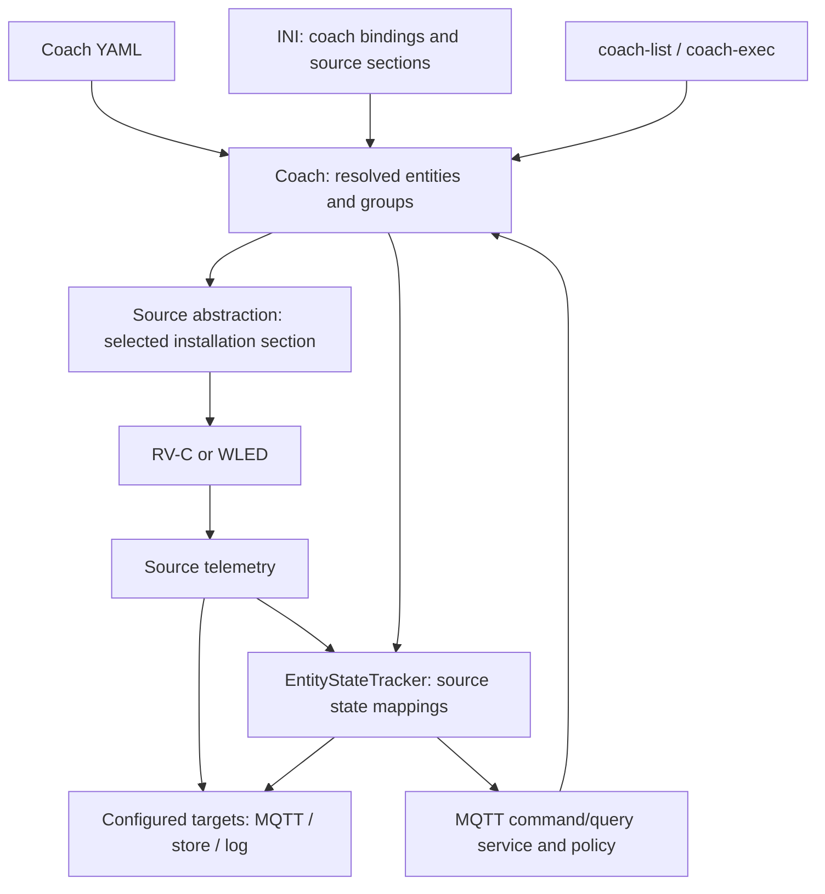

# Coach architecture and configuration

The coach is RV-Control's installation-independent semantic model: named lights,
fans, covers, climate zones, tanks, and other equipment, rather than CAN bytes or
controller URLs. It is used by local commands, entity telemetry, and the optional
MQTT command/query API. Treat the coach definition as a maintained product
interface, not a collection of ad hoc CAN commands.

Start here for architecture and the file format. Use
[RV-C discovery and coach authoring](RVC-DISCOVERY.md) to establish the mappings
for another vehicle, and [Coach MQTT command API](COACH-MQTT-COMMANDS.md) for
controller authorization, request/result schemas, and delivery guarantees.

## Three configuration layers

| Layer | File | Responsibility |
| --- | --- | --- |
| Protocol vocabulary | [rvc-spec.yml](../src/rv_control/data/rvc-spec.yml) | DGN names, wire fields and decoding; shared across coaches. |
| Coach semantics | [Thor Magnitude example](../src/rv_control/coaches/thor-magnitude-bh35-2020.yml) | Which instance is the kitchen fan, its actions and state, scenes, and forbidden command instances. |
| Installation and permissions | Local INI based on [config-example.ini](../config-example.ini), plus a local policy based on [config-example-controllers.yaml](../config-example-controllers.yaml) | Interfaces, hosts, credentials, enabled sources/targets, transport bindings, write gates, controller grants, and journal location. |

Do not put device addresses, credentials, SocketCAN interface names, or WLED
hosts in a shareable coach YAML. Conversely, do not put coach-specific instance
inventories or panel command sequences in the CLI or generic protocol helpers.
A model/year file is a starting point: options, wiring, and controller firmware
can differ between nominally identical coaches.

## Runtime structure



- [Coach](../src/rv_control/coach.py) loads YAML, resolves templates and
  placeholders, builds frames, checks reserved instances, and executes actions.
- [Source](../src/rv_control/sources/base.py) is the hardware boundary. The coach
  resolves a configured source section and uses its registered source type;
  it does not instantiate transport libraries directly.
- [CoachStatePublisher and EntityStateTracker](../src/rv_control/coach_state.py)
  supplement the original source publications with semantic entity state.
- [CoachCommandService](../src/rv_control/coach_commands.py) authorizes and
  preflights MQTT plans, journals results, and dispatches through running sources'
  reliable command interface. [CoachQueries](../src/rv_control/coach_queries.py)
  supplies monitoring operations.
- [CLI integration](../src/rv_control/cli.py) starts sources, wraps the target
  publisher, requests initial status, and optionally starts the MQTT service.

The coach is **not** a registered `type = coach` source or a separate hardware
thread. Do not add it to `[source] enabled-sources`. It is a layer over sources.
Current action builders support `rvc` and `wled`; the entity state tracker consumes
decoded RV-C messages and mapped source snapshots from any transport. BLE sources
keep their existing polling/notification schedules, without additional reads.

## Selecting and binding a coach

Merge this into the installation INI; the referenced source sections must exist:

```ini
[coach]
specfile = thor-magnitude-bh35-2020
rvc = rv_c_bus
wled = wled_patio
publish_state = true
state_republish_seconds = 60
request_status_on_start = true
```

The example INI shows complete source and target sections. The daemon's enabled
hardware still comes from `[source] enabled-sources`, for example
`rv_c_bus, wled_patio`. A binding alone does not start a source.

### Coach file selection

Selection precedence is:

1. Explicit `--coach-spec` on `coach-list` or `coach-exec`.
2. First nonblank `[coach] specfile`, `spec`, or `coach_spec`.
3. Legacy `[service] coach_spec`.
4. The packaged Thor Magnitude BH35 2020 definition.

An identifier may be an existing file path or a packaged `.yml` filename/stem.
Packaged files live in [coaches/](../src/rv_control/coaches/) and are included in
the distribution by [pyproject.toml](../pyproject.toml).
Existing relative paths are resolved from the **process working directory**, not
the INI directory. Use an absolute path for a private coach file in deployments
with a different working directory. Unlike coach spec paths, the MQTT service's
policy and journal paths are resolved beside the INI.

### Optional additive installation overlay

Keep factory mappings in `specfile` and installation customizations in one
optional YAML selected with `[coach] overlay`:

```ini
[coach]
specfile = thor-magnitude-bh35-2020
overlay = coach-overlay.yml
```

Missing or blank `overlay` loads only the factory definition. A configured file
must exist and parse successfully; there is no silent fallback. Relative overlay
paths resolve beside the INI (unlike existing relative factory paths). An explicit
CLI `--coach-spec` changes the factory selection but still applies the configured
overlay.

The loader merges **factory first, overlay second, then resolves inheritance**.
Overlays use the same top-level sections: `coach`, `templates`, `entities`,
`command_groups`, and `reserved`. They may add named definitions, absent metadata,
and new actions/schemas to existing templates/entities/groups. Existing values
must not be redefined, even identically. Existing action sequences, state
mappings and action schemas cannot be replaced or modified; ordinary lists are
not concatenated. `reserved` is the sole list exception: new restrictions append
to the factory restrictions, never remove them.

Conflicts fail with the overlay filename and conflicting definition path.
Resolved factory templates/entities are checked too: adding an entity-level
action or transport cannot silently shadow an inherited factory definition.
The merged model validates template inheritance, action schemas, state blocks,
frame waits, reserved instances, and group references/cycles without opening
hardware. Validation is not proof of device compatibility, complete raw-payload
semantics, or controller-specific WLED ID availability. Normal transport checks
and semantic command preflight still apply at execution.

Copy [wled-overlay-example.yml](../src/rv_control/coaches/wled-overlay-example.yml)
to a local `coach-overlay.yml` beside your INI to add the complete WLED template,
custom light, and scene. WLED templates and lights are installation customizations,
not part of the factory Thor definition.
That local filename is Git-ignored; the packaged example is shareable.
Neither the overlay nor its loading enables writes or grants controller access.
Keep MQTT grants in the separate controller policy, and restart after changes.
Source discovery and raw state operations do not depend on an overlay.

Automatic reload is off by default. `rvcontrol --config config.ini --reload-config run`
watches that INI's modification timestamp and bytes; a validated content change
gracefully restarts the full daemon session, rereading coach files and policy.
It does not watch YAML or policy files independently: restart manually after
those edits unless an INI content change also triggers reload. This is a restart,
not live mutation of coach mappings; observations are rebuilt and write gates
remain in force. See [configuration reload](../README.md#optional-configuration-reload)
for validation, cleanup and failure behavior. Explicit coach selection is
recommended so a new installation does not accidentally use the default Thor mappings.

### Transport bindings

An entity normally declares `transport: rvc` or `transport: wled` through its
template. Resolution collects its nonblank `target`, `config_section`, and
`transport` strings in that order. It first looks for those keys in `[coach]`;
if none has a mapping, it tries them as literal INI section names.

For example, `transport: rvc` plus `[coach] rvc = rv_c_bus` dispatches through
`[rv_c_bus] type = rvc`. An entity can use `target: roof_lights` with
`[coach] roof_lights = wled_roof` for a second WLED installation binding while
retaining `transport: wled` as its action format.

Keep the bound source type consistent with the entity transport. Prefer logical
bindings over installation-specific `config_section` values in reusable YAML.
The local executor can construct a source on demand; the semantic MQTT API
requires the affected source to be enabled, running, and command-ready.

### Multiple WLED controllers

`wled` is a transport type, **not a singleton device**. Any number of named
source sections can use `type = wled`, each with its own host, polling loop,
HTTP session, write gate, and telemetry topic. A single `wled = wled_patio`
binding is only a default for entities without a more specific logical target;
it does not limit the coach to one controller.

The Thor installation has two customized WLED devices. The factory coach file
does not define `patio_light`; the local overlay and shareable WLED example add
that entity and its dependent `evening_scene`. The second physical device is
not yet mapped. The following two-controller example uses illustrative
labels/hosts, not an asserted mapping of that second device:

```ini
[source]
enabled-sources = rv_c_bus, wled_patio, wled_roof

[coach]
specfile = thor-magnitude-bh35-2020
rvc = rv_c_bus
patio_strip = wled_patio
roof_strip = wled_roof

[wled_patio]
type = wled
base_url = http://patio-wled.local
topic = wled/patio
write_enabled = false

[wled_roof]
type = wled
base_url = http://roof-wled.local
topic = wled/roof
write_enabled = false
```

These are fragments to merge with a complete INI. In the selected coach YAML,
both entities reuse `wled_light`, but select different logical bindings:

```yaml
entities:
  patio_light:
    name: Patio strip
    template: wled_light
    target: patio_strip
  roof_light:
    name: Roof strip
    template: wled_light
    target: roof_strip
```

Both retain inherited `transport: wled`. The explicit `[coach]` target mappings
select their source sections ahead of a generic `wled` mapping. Use explicit
bindings for every controller when ambiguous fallback would be undesirable.
In particular, an unmapped/misspelled `target` can fall through to a configured
generic `wled` binding; it is not automatically rejected as an unknown target.
Inspect `coach-list`'s resolved `config_section` for every entity before writes.

Groups/scenes may include entities on either controller without a new transport
or group format. Semantic MQTT grants remain entity/action-based, and each
resolved source must independently be enabled, running, and write-enabled.
Use distinct source telemetry topics to keep their snapshots distinguishable.
The example's `state` mapping converts WLED snapshots into coach entity state.
Each entity follows the telemetry topic of its resolved source section, so
controllers with distinct topics remain isolated. Explicit `refresh_states`
also supports bounded WLED state reads without enabling writes.

## Coach YAML reference

The file is a YAML mapping with these conventional top-level sections:

| Section | Contents |
| --- | --- |
| `coach` | Descriptive identity, normally `manufacturer`, `model`, `model_year`. |
| `templates` | Reusable entity definitions, optionally extending another template. |
| `entities` | Stable machine identifiers mapped to named equipment. |
| `command_groups` | Shared actions across members or ordered scenes. |
| `reserved` | DGN/instance pairs forbidden in coach-generated command frames. |

The loader is not a complete external schema validator. Some errors are detected
at load time, others when state mappings compile or actions/policies are
prepared. Passing `check` alone does not validate a coach file or prove its
hardware behavior.

### A complete small example

This is a format example, **not a verified mapping for another vehicle**. Instance
20 and group 255 come from the supplied Thor file; replace them with observations.
No writes are enabled by this YAML.

```yaml
coach:
  manufacturer: Example
  model: Demonstration
  model_year: 2026

templates:
  switched_load:
    transport: rvc
    action_schemas:
      on: {}
      off: {}
    actions:
      on:
        - {dgn: 0x1FEDB, instance: "{instance}", group: 255, level: 100, command: on, delay: 255}
      off:
        - {dgn: 0x1FEDB, instance: "{instance}", group: 255, level: 0, command: off, delay: 255}
    state:
      dgn: 0x1FEDA
      match: {instance: "{instance}"}
      fields:
        on: {field: loadstatus, map: {0: false, 1: true}}
        level: {field: operatingstatusbrightness, invalid: [255]}

entities:
  kitchen_fan:
    name: Kitchen fan
    kind: fan
    area: kitchen
    template: switched_load
    instance: 20
    verified: false

command_groups:
  all_fans:
    description: All mapped fans
    members: [kitchen_fan]
    actions: [on, off]

reserved:
  - {dgn: 0x1FEDB, instances: [43, 44]}
```

### Entities, inheritance, and parameters

Use stable snake_case entity keys: they become command targets and topic suffixes.
`name`, `kind`, and `area` are display metadata, not protocol addresses.
`template` selects a template; a template's `extends` selects its parent.
Inheritance loops are rejected.

Child definitions override parent keys. Only `actions` and `action_schemas`
merge by action name; a child `state` block or list **replaces** the inherited
state, rather than extending it. A template's description is not automatically
the entity description.

Placeholders such as `"{instance}"` are filled from the entity's own scalar keys
at load time; `{entity}` is its machine identifier. Substitution applies to
mapping keys too, enabling pairs with configurable action names. Remaining
action placeholders, such as `"{level}"`, must be supplied at execution time.
A whole-placeholder value preserves the supplied type; embedded placeholders
are textual. State mappings cannot contain unresolved placeholders.

For semantic MQTT actions, declare an `action_schemas` entry for each exposed
entity action, including `{}` for parameterless actions. Supported scalar types
are `number`, `integer`, `boolean`, and `string`, with numeric `min`/`max` and
scalar `enum` restrictions. All declared parameters are required. This strict
schema is enforced by the semantic MQTT service; legacy local `coach-exec`
uses its existing parameter conversion and frame validation, not that policy.

`verified` and `notes` record evidence. **`verified: false` is not a write gate.**
Omit unsafe/unknown actions and withhold policy grants; do not rely on this flag
to prevent execution. `confirm: true` requires explicit confirmation, but is not
authorization and does not verify the mapping.

### Actions and frames

An action is an ordered list of frame mappings (a single mapping is normalized
to a list). `wait` is a delay **before that frame**, between 0 and 60 seconds.
All frames of a local entity action are built and checked before its first send.
This is not a transaction: transport failure can leave an action partly sent.

For `rvc`, provide a `dgn` and either:

- Named `DC_DIMMER_COMMAND_2` fields: `instance`, `group`, `level` in percent,
  `command`, `delay`, and optional `interlock`. The canonical builder encodes
  half-percent units; do not pre-double `level`.
- A hexadecimal `payload` for other command DGNs, or for an exact captured
  payload. Classic CAN payloads must not exceed eight bytes.

Short coach payloads are padded to eight bytes with `FF`. `delay` is an on-wire
protocol value, **not** the local `wait`. Preserve observed sentinel bytes,
timing, and multi-frame ordering. The RV-C source section supplies integer
`priority` and `source` settings; defaults are 6 and 0 respectively. The executor
does not claim or negotiate a free source address on your behalf.

For `wled`, a frame is a WLED JSON state object, optionally with `wait` removed
before dispatch. Brightness uses WLED's `bri` range 0-255, not RV-C percent.
See the `wled_light` template in the
[WLED example overlay](../src/rv_control/coaches/wled-overlay-example.yml).

### Source-owned action interface

Existing coach/installation YAML does not need to change. Coach still resolves
entity actions, placeholders, confirmation, groups and per-frame waits. It now
passes each resolved frame to a `WritableSource` adapter, rather than encoding
CAN frames or constructing WLED state updates itself.

The writable-source contract is implemented by RV-C and WLED:

| Method | Contract |
| --- | --- |
| `supported_actions()` | Return source-owned action definitions and parameter schemas, without hardware access. |
| `describe_actions()` | Return a fresh JSON-compatible description of those actions. |
| `translate_frame(frame)` | Map an existing YAML frame to a source action name and parameters. Coach removes `wait` first. |
| `prepare_action(name, params, section, reserved=...)` | Validate and encode without constructing sources or contacting hardware. Return an immutable snapshot and a dispatch planning budget. |
| `execute_action(name, params)` | Recheck source write permission/readiness, validate again, and dispatch once; failures raise. |
| `handle_action(name, params)` | Compatibility adapter for local `coach-exec`, retaining the legacy command handler's logging behavior. |

Discovery and preparation are class methods, so preflight does not create extra
HTTP sessions or CAN sources. Unknown actions/parameters, missing required
parameters, invalid types and out-of-range values are rejected. Parameters with
a `default` in their source schema are optional; other parameters are required.
Source schemas also support object parameters for advanced state updates and
string/integer alternatives for RV-C command codes. Prepared parameter/payload
accessors return independent copies.

Inspect supported names and exact contracts without starting collectors:

```sh
rvcontrol --config config.ini source-actions rvc
rvcontrol --config config.ini source-actions wled
```

RV-C advertises `dc_dimmer` (instance, command, optional group/percent level/delay/
interlock) and `frame` (DGN and hexadecimal payload). Its adapter retains named
and numeric command support, canonical protocol encoding, address settings,
eight-byte padding and coach reserved-instance checks.

WLED advertises `on`, `off`, `brightness`, `color`, `effect`, `palette`,
`transition`, `preset` and an advanced `state` action accepting a non-empty JSON
state object. Exact existing lighting recipes translate into named actions;
other JSON updates use `state` without dropping custom fields. The destination
always comes from the configured source, never action parameters. Source
validation also applies to recognized local coach recipes; this does not add
controller-policy validation to local `coach-exec`.

Source action names are separate from entity-facing action names. For example,
an entity's `on` can map to RV-C `dc_dimmer`, while a WLED entity's custom
`evening` action can map to `preset`. Entity `action_schemas` and controller
policies remain unchanged and can restrict access further.

Catalogs describe implemented support, not controller authorization, current
readiness, discovered firmware features, or verified physical outcomes. The
existing MQTT `capabilities` query continues to describe authorized **entity**
actions, not grant access to raw source actions. No MQTT topics or configuration
keys are added.

The semantic executor sums source-provided budgets instead of branching on
transport type. RV-C reserves its one-second send timeout; WLED reserves three
times its configured timeout for lock/connection/response waits. The semantic
30-second plan limit therefore still limits WLED timeouts to at most ten
seconds; larger positive timeouts remain usable locally. This is a planning
budget, not a strict total HTTP deadline. Each YAML frame remains one journaled
dispatch step, preserving existing partial/unknown outcome accounting and
no-retry behavior.

### WLED controls and discovery

The Python source provides read-only `effects()` and `palettes()` catalogs via
`GET /json/effects` and `GET /json/palettes`. The standalone tool exposes the
same operations:

```sh
PYTHONPATH=src .venv/bin/python tools/wled_tool.py --config config.ini --section wled_patio effects
PYTHONPATH=src .venv/bin/python tools/wled_tool.py --config config.ini --section wled_patio palettes
```

Both return JSON arrays of names in the order supplied by that controller;
array indexes are the corresponding catalog IDs. Order, duplicate names, and
empty lists are preserved. Invalid response shapes and HTTP errors fail
explicitly. Catalogs are read on demand, not on every poll, and require no
write flag. Available effects, palettes, and segments depend on firmware and
hardware; numeric schema bounds are not proof that an ID exists on a device.
Special/custom palette IDs may not appear in the returned name catalog.

The [WLED example overlay](../src/rv_control/coaches/wled-overlay-example.yml)
defines the complete `wled_light` template and its custom light entity.
All actions below belong to the overlay; the factory Thor definition has no WLED
template or lights:

| Action | Required parameters | State update |
| --- | --- | --- |
| `on` / `off` | None | Controller `on` flag. |
| `brightness` | `bri`: integer 0-255 | Turns output on and sets brightness. |
| `color` | `segment`, `red`, `green`, `blue`: integers 0-255 | Primary RGB color of the explicitly addressed segment. |
| `effect` | `segment`, `effect_id`: integers 0-255 | Segment effect (`fx`). |
| `palette` | `segment`, `palette_id`: integers 0-255 | Segment palette (`pal`). |
| `transition` | `duration`: integer 0-65535 | Controller default transition duration, in WLED's 100 ms units. |
| `preset` | `preset_id`: integer 1-250 | Apply an existing saved preset (`ps`); does not save or delete presets. |

Segment parameters select an existing segment explicitly, rather than relying
on WLED's selected/main-segment behavior. They do not create LED ranges.
`color`, `effect`, `palette`, and `transition` do not implicitly turn output on,
change brightness, or enable a disabled segment. A color update does not force
the Solid effect; the active effect determines how it uses primary color.
A preset can change multiple saved settings, including output state.

`transition` changes the controller's default crossfade setting, not a local
sleep or one-shot `tt` override. For example `duration = 10` requests one second.
Firmware may cap the effective duration; the schema represents the API field
range, not a guarantee of a 6553.5-second fade. Refer to the controller's version
of the [WLED JSON API](https://kno.wled.ge/interfaces/json-api/).

Examples for a configured, reviewed installation:

```sh
rvcontrol --config config.ini coach-exec patio_light color -p segment 0 -p red 255 -p green 80 -p blue 20
rvcontrol --config config.ini coach-exec patio_light effect -p segment 0 -p effect_id 0
rvcontrol --config config.ini coach-exec patio_light palette -p segment 0 -p palette_id 0
rvcontrol --config config.ini coach-exec patio_light transition -p duration 10
rvcontrol --config config.ini coach-exec patio_light preset -p preset_id 1
rvcontrol --config config.ini mqtt-command patio_light color --param segment 0 --param red 255 --param green 80 --param blue 20
```

Semantic MQTT validates all declared parameters and requires an explicit grant
for each new action; the example controller policy shows optional commented
grants for `patio_light`. Uncomment them only when the overlay is loaded and
access is intended; existing local policies are not changed automatically.
Local `coach-exec` retains legacy frame validation rather than enforcing the
MQTT scalar schemas. Direct tool `state` and source `set_state()` remain
advanced raw JSON interfaces. No configuration-write API, preset-file management,
boot waiting, or awning power sequencing is introduced by these actions.
No additional MQTT telemetry topics are created.

### Command groups

A group can use `members: [entity_a, entity_b]` and `actions: [on, off]` to
apply the selected action in member order. Or define a scene:

```yaml
command_groups:
  evening:
    actions:
      activate:
        - {entity: living_ceiling_light, action: brightness, params: {level: 30}}
        - {entity: bedroom_ceiling_light, action: off}
```

Runtime parameters override step parameters. Referenced entities/actions must
exist. Avoid recursive groups. Local execution expands and executes sequentially;
it does not preflight the entire group before the first entity runs. Semantic
MQTT execution additionally checks the entire expanded plan and all grants
before writes. Neither path rolls back completed hardware operations.

### Reserved instances

`reserved` accepts a numeric `dgn` and `instances` list (or singular `instance`).
Checks apply at load time where static values are known and again when building
frames, including byte zero of a raw payload. These are command safeguards,
not a telemetry filter: a reserved tank input may still be observed.
The byte-zero check is not a universal semantic validator for every possible DGN.
It also does not govern standalone send tools or legacy raw source MQTT commands.

## State mappings and freshness

`state` is one block or a list. RV-C blocks have a status `dgn`, optional `match`
fields, and a `fields` mapping from entity attributes to decoded fields.
Use numeric YAML DGNs (for example `0x1FEDA`) and exact canonical decoder names.
Each match value may be a scalar or a list of accepted values; all match fields
must agree. Include `source` when observations justify filtering a sender.
Current matching is by decoded content, not the originating INI section; do not
assume two buses with identical DGNs/instances are automatically isolated.

For other sources, omit `dgn` to consume snapshots at the telemetry topic of
the entity's resolved INI section. This supports every registered source,
including Renogy and Hughes, using their existing periodic reports rather than
adding BLE interrogations or changing their cadence. An optional `topic_suffix`
selects a subtopic such as gpsd's `TPV`; it cannot be combined with `dgn`.
Matching and field conversions work as for RV-C. Only explicitly mapped fields
are exposed; source commands are never treated as observed state.

For example, add this to an existing WLED template in the local overlay:

```yaml
state:
  fields:
    on: "on"
    bri: bri
    level: {field: bri, divide_by: 255, scale: 100, round: 1}
```

The daemon polls WLED at its source's `poll_interval` (default 60 seconds).
Brightness readback includes the raw 0-255 `bri` and percent `level`; updates from
other controllers or the WLED app follow the same path. Temporary HTTP failures
are logged and retried on the next poll. Sources must still be enabled under
`[source] enabled-sources`; a coach binding does not start hardware collectors.

A field can be a decoded field name or a mapping containing:

| Key | Effect |
| --- | --- |
| `field` | Required decoded source field. |
| `invalid` | Raw values to publish as JSON `null`, checked before conversion. |
| `divide_by` | Numeric divisor, or the name of another decoded field. |
| `scale`, `offset` | Multiply and add after division. |
| `round` | Decimal places; zero produces an integer. |
| `map` | Convert the resulting value to a label/boolean; unmatched values pass through. |

Order: invalid check, `(raw / divisor) * scale + offset`, rounding, mapping.
Missing fields are skipped, not fabricated as zero or false. Conversion failures
are logged at debug level and skipped. New values merge into the entity's prior
attributes; fields from different DGNs need not have arrived simultaneously.

The daemon forwards raw telemetry unchanged and publishes entity changes at
`<base_topic>/coach/entity/<entity>`, for example:

```json
{
  "entity": "kitchen_fan",
  "name": "Kitchen fan",
  "kind": "fan",
  "area": "kitchen",
  "state": {"on": true, "level": 100.0},
  "updated": "2026-10-18T12:00:00+00:00"
}
```

Unchanged state is republished after `state_republish_seconds` **when another
matching observation arrives**, not by an independent heartbeat. Zero disables
unchanged republishing. Silent equipment can therefore retain old state; the
`updated` field is a publication timestamp, not a freshness guarantee for every
attribute. Queries expose observation/freshness details; republishing cached
state does not read hardware.

`request_status_on_start = true` asks running sources once for the mapped status
DGNs or a safe source snapshot. RV-C broadcasts status requests and WLED reads
`/json/state`, without requiring actuator write flags. Sources without a safe
status-request interface continue reporting on their existing schedule.
The shared `Source.request_status(status_ids)` interface accepts source-defined
status identifiers, not coach entity IDs. Only RV-C interprets those identifiers
as DGNs; whole-snapshot sources such as WLED do not need individual identifiers.
Some controllers may not respond; request transmission is not proof of fresh
state. `publish_state = false` suppresses entity publications, but a tracker
still exists if the MQTT API needs it.

## Operations and write boundaries

From the repository working directory:

```sh
rvcontrol --config config.ini coach-list
rvcontrol --config config.ini coach-list --coach-spec /path/to/new-coach.yml
# Physical actions: only after installation-specific validation and write enablement.
rvcontrol --config config.ini coach-exec kitchen_fan on
rvcontrol --config config.ini coach-exec generator start --confirm
```

`coach-list` loads/resolves the coach without opening hardware; an empty resolved
section in its output means a binding is unresolved, not that it was validated.
Local `coach-exec` dispatches through legacy source handlers and source-level
write flags. It does not use the MQTT policy or journal; its printed `status`
is not hardware acknowledgement, and a legacy handler may log a disabled write
instead of raising.

For dashboards and correlated outcomes, use the implemented, opt-in
[semantic MQTT API](COACH-MQTT-COMMANDS.md). Queries require their own enablement
and grants but no actuator write flags. Physical MQTT actions require endpoint
enablement, MQTT and source write flags, controller grants for the full plan,
and any required confirmation. A successful dispatch still does not prove that
equipment moved: validate with telemetry and physical observation.

## Maintenance and validation

Keep additions transport-independent, evidence-backed, and hardware-free-testable.
Add tests for template resolution, payloads and timing, reserved instances, state
conversions, and MQTT schemas/grants affected by a new definition. Relevant suites:

- [test_coach.py](../tests/test_coach.py) and
  [test_coach_source_dispatch.py](../tests/test_coach_source_dispatch.py)
- [test_coach_state.py](../tests/test_coach_state.py)
- [test_coach_commands.py](../tests/test_coach_commands.py),
  [test_coach_queries.py](../tests/test_coach_queries.py), and
  [test_coach_mqtt_routing.py](../tests/test_coach_mqtt_routing.py)

The [authoring guide](RVC-DISCOVERY.md) provides the acceptance checklist.
Software tests establish structure and encoding, never physical compatibility
with a different coach. Preserve local captures privately and redact installation
details before sharing evidence.
